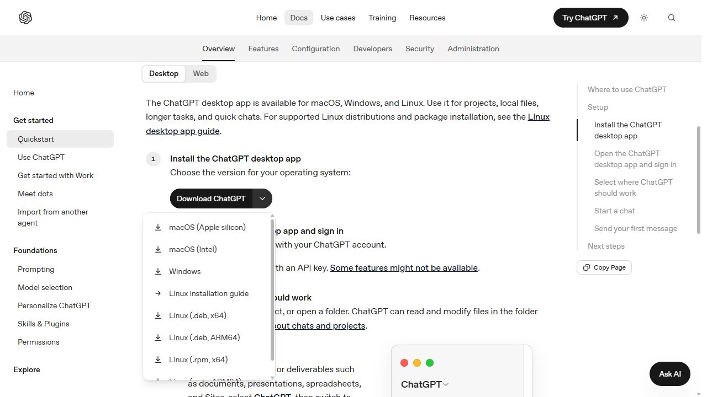
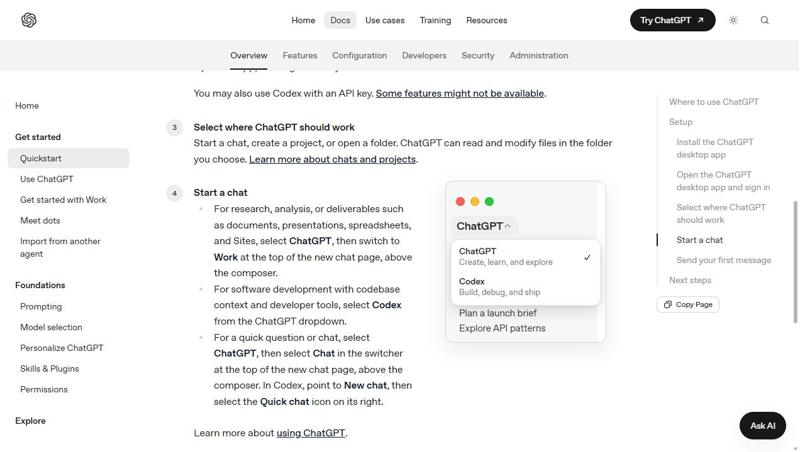
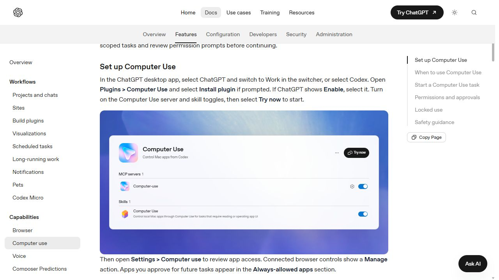
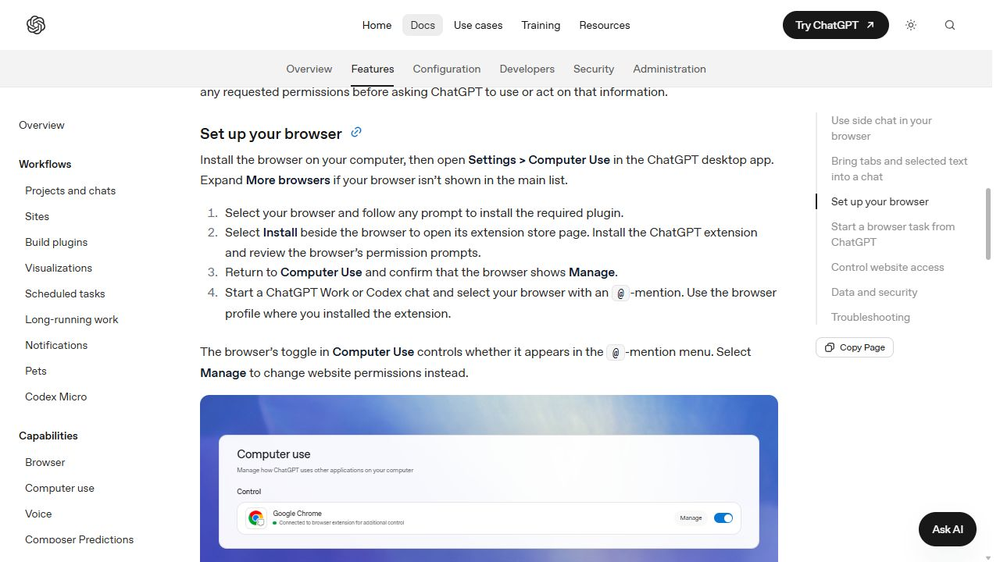

# 필독문서 — 처음 쓰는 만승 교무팩

**개발을 몰라도 사용할 수 있습니다. 설치한 뒤에는 ChatGPT에 평소 말하듯 업무를 요청하면 됩니다.** 이 문서는 Windows PC에서 만승 교무팩을 처음 준비하는 선생님을 위한 안내입니다. AI가 따라야 할 필독 규칙은 최상단 [SKILL.md](SKILL.md)에 있습니다.

이 팩은 업무를 대신하는 계정이 아니라 **ChatGPT가 선생님의 PC와 로그인된 프로그램을 올바른 방법으로 사용하도록 돕는 도구 모음**입니다. 학교 계정·프로그램은 선생님이 준비해야 합니다. 다른 학교에서도 사용할 수 있지만, 충북소통메신저·학교 업무포털처럼 지역·기관에 따라 사용할 수 없는 기능이 있습니다.

## 1. 먼저 준비할 것

이 팩을 가장 효과적으로 사용하려면 **Windows용 ChatGPT 프로그램을 설치하고, 월 20달러 ChatGPT Plus 이상을 구독한 계정으로 로그인한 뒤, 앱 안에서 Codex로 전환**하는 구성을 권장합니다. 파일과 설치 스크립트를 직접 다루는 이 팩의 사용 안내는 그 환경을 기준으로 합니다.

이는 **만승 교무팩의 권장 사용 환경**입니다. 공식 문서에는 무료·Go의 일부 Codex 이용도 안내되어 있으므로 “20달러를 결제해야만 Codex가 열린다”는 뜻은 아닙니다. 2026년 10월 15일 확인한 Plus 기본 가격은 월 20달러이며 실제 결제 금액·세금·환율·계정별 기능과 사용량은 결제 화면을 확인하세요. 이미 해당 구독이 있으면 추가 구독은 필요 없습니다. ChatGPT 구독과 API 요금은 별개입니다. [공식 요금 안내](https://learn.chatgpt.com/docs/pricing)

| 준비물 | 쉬운 설명 |
| --- | --- |
| Windows PC와 인터넷 | 학교 프로그램이 설치된 본인 PC를 사용합니다. |
| ChatGPT 데스크톱 앱과 계정 | 인터넷 창의 일반 채팅 대신 아래 안내대로 앱을 준비합니다. |
| Python 3.10 이상 | 팩 설치와 일부 도구를 실행하는 프로그램입니다. 설치 확인은 ChatGPT에 맡길 수 있습니다. |
| 기능별 프로그램·계정 | 한컴오피스, 이지에듀, 충북소통메신저, 하이클래스, 업무포털 중 사용할 것만 준비합니다. |
| 시간표를 쓸 때 공개 공유시트 링크 | 자기 학교 시간표의 다운로드 가능한 Google Sheets 링크입니다. |

비밀번호·인증서 암호·인증번호 입력이나 권한 허용 화면은 선생님이 직접 처리합니다. 이 팩을 설치했다고 학교 서비스에 자동 가입되거나 권한이 생기지는 않습니다.

## 2. Windows용 ChatGPT 설치

1. [공식 설치 안내](https://learn.chatgpt.com/docs/quickstart?setup=app#setup-app-install)를 엽니다.
2. `Desktop`을 선택합니다. 다운로드 버튼 옆 화살표에서 **Windows**를 고릅니다.
3. 내려받은 공식 설치 프로그램으로 설치하고 실행합니다.
4. 사용할 ChatGPT 계정으로 로그인합니다. 구독할 경우 같은 계정에서 Plus 이상을 선택하고 결제는 직접 진행합니다.

화면 설명: 다운로드 메뉴 안의 **Windows**를 선택합니다. 위 사진은 공식 문서를 브라우저에서 캡처한 것으로, 설치가 끝난 본인 PC 화면은 아닙니다.

## 3. ChatGPT에서 Codex로 바꾸기

앱의 **ChatGPT라고 적힌 제품 선택 메뉴**를 열고 **Codex**를 선택합니다. 아래 공식 예시처럼 ChatGPT와 Codex가 함께 보이는 메뉴입니다. 화면 위치나 번역은 앱 버전에 따라 다를 수 있습니다. [공식 시작 안내](https://learn.chatgpt.com/docs/quickstart?setup=app#setup-app-start-task)

화면 설명: 펼쳐진 메뉴의 **Codex**를 누릅니다. 예시 그림의 창 모양은 macOS지만, Windows에서도 같은 제품 이름을 찾으면 됩니다. 이것은 모델 이름을 바꾸는 메뉴와 다릅니다.

팩 설치나 파일 작업을 부탁할 때에는 새 대화를 만들고, 압축을 푼 팩 폴더를 프로젝트로 열거나 그 위치를 알려줍니다. 학교 업무 파일은 본인이 지정한 폴더에서 작업하게 합니다.

## 4. Computer Use 플러그인 켜기

Computer Use(컴퓨터 유즈)는 ChatGPT가 Windows 프로그램의 화면을 보고 조작할 때 쓰는 기능입니다.

1. 앱의 **Plugins / 플러그인**을 엽니다.
2. **Computer Use**를 찾아 **Install plugin / 설치**를 누릅니다. 이미 설치되었다면 설치를 반복할 필요가 없습니다.
3. **Enable / 활성화**가 보이면 켭니다.
4. 플러그인 안의 **MCP servers**와 **Skills** 항목에서 Computer Use 관련 스위치가 켜져 있는지 확인합니다.
5. 설정의 **Computer use / 컴퓨터 사용**에서 필요한 앱의 접근 상태를 확인합니다. 첫 이용 시 나타나는 앱 접근 요청은 본인이 확인합니다.

화면 설명: 파란 스위치 두 곳이 켜진 상태입니다. 공식 예시 안에는 Mac 문구가 남아 있지만 공식 설명은 Windows도 지원한다고 안내합니다. Windows에서 화면을 조작하는 동안에는 해당 앱을 열어 두고 마우스·키보드 조작을 잠시 맡겨 주세요. [공식 Computer Use 안내](https://learn.chatgpt.com/docs/computer-use)

팩의 모든 기능을 컴퓨터 유즈로 누르는 것은 아닙니다. 한글·이지에듀·메신저는 제공된 실행 도구를 쓰고, 포탈의 WXS도 전용 CLI를 사용합니다. 사용자가 어떤 방식을 골라야 할지는 필독 스킬이 판단합니다.

## 5. 브라우저 컨트롤 연결하기

브라우저 컨트롤은 ChatGPT가 **이미 로그인된 Chrome·Edge 등의 웹사이트**를 읽고 조작하게 연결하는 기능입니다. 하이클래스와 업무포털의 웹 화면에서 사용합니다. Computer Use 설치와 브라우저 확장 연결은 각각 확인해야 합니다.

1. 사용할 Chrome 또는 Edge를 실행합니다.
2. ChatGPT 앱에서 **Settings / 설정 → Computer Use**를 엽니다.
3. 사용할 브라우저를 선택합니다. 목록에 없으면 **More browsers / 다른 브라우저**를 펼칩니다. 필요한 플러그인 설치 안내가 나오면 따릅니다.
4. 브라우저 옆 **Install / 설치**를 눌러 연결되는 **공식 확장 스토어**에서 ChatGPT 확장을 추가합니다. 권한 설명은 본인이 읽고 허용합니다.
5. ChatGPT 설정으로 돌아왔을 때 브라우저 옆이 **Manage / 관리**로 보이면 연결된 상태입니다. 해당 브라우저 스위치도 켭니다.
6. **새 대화**에서 `@`를 입력해 Chrome 또는 Edge를 골라 봅니다. 확장을 설치한 것과 같은 브라우저 프로필을 사용해야 합니다.

화면 설명: 예시는 Google Chrome 옆에 **Manage**와 켜진 스위치가 표시됩니다. Edge도 설정에서 자신이 쓰는 브라우저를 연결하면 됩니다. 홈페이지 방문 허용 화면이 나오면 필요한 사이트 범위를 확인합니다. [공식 브라우저 연결 안내](https://learn.chatgpt.com/docs/chrome-extension#set-up-your-browser)

연결 시험은 이렇게 부탁합니다. `@Chrome` 또는 `@Edge`는 직접 타이핑만 하는 대신 `@` 메뉴에서 실제 브라우저를 선택하세요.

> @Chrome 현재 연결된 브라우저와 열린 탭을 확인해줘. 사이트에 글을 쓰거나 보내지는 말아줘.

## 6. 만승 교무팩 내려받기와 설치

1. [만승 교무팩 ZIP 내려받기](https://github.com/y5496694/mansung-gyomu-pack/archive/refs/heads/main.zip)를 누릅니다.
2. 받은 ZIP에서 **모두 압축 풀기**를 선택합니다. 예를 들어 문서 폴더 안에 `mansung-gyomu-pack-main` 폴더를 둡니다.
3. Codex에서 압축을 푼 폴더를 엽니다. 폴더를 선택하기 어렵다면 아래 요청에 **실제 폴더 경로**를 붙여 넣습니다.
4. 다음 문장을 그대로 요청합니다.

> 이 폴더의 만승 교무팩을 설치해줘. 최상단 AGENTS.md와 SKILL.md, 필독문서.md를 먼저 읽고, Python 실행 환경을 확인한 뒤 install.ps1로 설치해줘. 원본 packages는 수정하지 말고 필독 스킬을 포함한 10개 스킬이 설치됐는지 확인해줘. 실제 학교 일정·쪽지·공지·공문은 만들거나 보내지 마. 내 폴더 위치는 여기에 적을게: [압축을 푼 실제 폴더 경로]

Python이 없으면 Codex가 알려 주는 필요한 프로그램을 확인하고 [Python 공식 사이트](https://www.python.org/downloads/windows/)에서 설치합니다. 메신저를 쓰려면 Node.js 22.19 이상도 필요합니다. 명령어를 잘 모르면 **“내가 누를 곳과 확인할 문구를 한 단계씩 설명해줘”**라고 요청하세요. 보안 차단이 발생하면 오류를 알려 주고, 보안 기능을 무작정 끄지 않습니다.

설치가 끝나면 **새 대화**를 시작합니다. 기존 대화에는 새 스킬 목록이 바로 나타나지 않을 수 있습니다. 처음에는 이렇게 요청하세요.

> 만승 교무팩 필독 스킬(mansung-gyomu-pack)을 먼저 읽고 앞으로 이 팩의 학교 업무에 적용해줘. 설치된 필독 스킬과 9개 업무 스킬을 확인하고 영역별 도구를 알려줘.

ZIP만 첨부하거나 주소만 알려 주었다고 설치가 끝난 것은 아닙니다. **설치 완료와 새 대화에서의 스킬 발견**을 확인하세요. 이 팩은 GitHub에서 받는 로컬 스킬 묶음이며, 공개 플러그인 목록에서 같은 이름을 검색해야 설치되는 방식은 아닙니다.

## 7. 앞으로는 이렇게 명령하세요

도구 이름을 매번 외울 필요는 없습니다. 필독 스킬은 다음처럼 분류합니다.

| 하고 싶은 일 | 반드시 사용하는 도구 | 그대로 말해 볼 문장 |
| --- | --- | --- |
| 일정·스케줄·스케쥴 | **이지에듀** | 오늘 학교 일정과 이번 주 내 일정을 확인해줘. |
| 학교 시간표·시간표 | **classtime** | 오늘 3학년 1반 3교시가 무슨 과목인지 확인해줘. |
| 학부모 소통·공지사항·안내·가정통신문 | **하이클래스** | 우리 반 체험학습 안내 초안을 준비하고 게시 직전에 멈춰줘. |
| HWP·HWPX·한글 파일 | **나래한글** | 이 한글 파일을 읽고 본문과 표를 요약해줘. |
| 쪽지·대화·교직원 연락 | **CBE CLI** | 충북소통메신저의 읽지 않은 쪽지를 보여줘. |
| 공문·기안·복무·출장·결재·접수 | **교무나래 포탈** | 에듀파인 문서등록대장에서 이번 달 공문을 찾아줘. |

**한글 파일은 읽기만 해도 나래한글을 써야 합니다.** “나래한글을 사용해”를 매번 덧붙이지 않아도 적용하도록 보강했습니다. 나래한글 이름을 말했더라도 실행 도구를 실제로 사용하지 않았다면 올바르게 처리한 것이 아닙니다.

복합 업무도 한 문장으로 요청할 수 있습니다.

> 첨부한 가정통신문.hwpx를 나래한글로 읽고, 하이클래스에 올릴 학부모 안내 초안을 준비해줘. 실제 게시와 발송은 하지 마.

> classtime으로 우리 반 주간 시간표를 확인해서 나래한글 HWPX 문서로 만들어줘. 이지에듀의 학교 행사 일정은 별도로 정리해줘.

공지 문구만 쓰기, 파일 만들기, 사이트에 입력하기, 임시저장하기, 실제 보내기는 서로 다른 단계입니다. 원하는 마지막 단계를 함께 말하면 편합니다. 출장·접수·결재 요청도 포탈로 연결하지만 **현재 구현되지 않은 절차나 최종 상신·승인·실제 공문 발송을 대신 완료해 주는 것은 아닙니다.**

## 8. 폴더별 사용법과 확인할 결과

설치가 끝났다면 [폴더별 쉬운 사용법](docs/폴더별_사용법.md)을 읽어 보세요. 여섯 도구의 역할, 미리 준비할 것, 붙여 넣을 요청문, 완료 후 확인할 결과를 각 폴더의 스킬에 맞춰 설명했습니다. 나래한글 안의 엔진·스킬·양식·문구·유틸리티 폴더도 함께 설명합니다.

## 9. 잘 안 될 때

| 증상 | 이렇게 요청하세요 |
| --- | --- |
| 한글 파일인데 다른 방법으로 읽으려고 함 | “만승 교무팩 필독과 narae-hangul 스킬을 다시 읽고, 포함된 narae.py의 inspect 작업을 실제 실행해줘. 실행 여부를 알려줘.” |
| 스킬을 못 찾음 | “설치 위치와 필독 포함 10개 SKILL.md를 확인해줘.” 확인 후 새 대화를 시작합니다. |
| 브라우저를 못 찾음 | 설정의 Computer Use에서 해당 브라우저가 Manage인지, 스위치가 켜졌는지, 확장이 설치된 프로필인지 확인합니다. 앱·브라우저 업데이트 후 새 대화로 시도합니다. |
| 메신저·이지에듀 연결 안 됨 | 해당 프로그램을 본인 계정으로 로그인한 뒤 “스킬의 연결 상태와 필요한 설정만 확인해줘”라고 요청합니다. |
| 시간표에 연결할 자료가 없다고 함 | 자기 학교의 공개 공유시트 링크를 제공합니다. 다른 학교나 예전 시간표로 추정하게 하지 않습니다. |
| 비밀번호·인증서·권한 확인 창이 나옴 | 해당 부분은 직접 처리하고 “완료했어. 현재 화면을 확인하고 이어가줘”라고 말합니다. |
| 업데이트가 필요함 | 최신 ZIP을 다시 받아 압축을 풀거나 Git으로 팩을 갱신한 뒤 “최상단 스킬을 읽고 update.ps1로 업데이트해줘. 로컬 설정은 보존해줘”라고 요청합니다. |

스킬 파일은 AI가 참고하는 규칙이므로 설치·활성화·현재 대화 상태에 따라 발견 여부를 확인해야 합니다. 파일을 맨 위에 둔 것만으로 모든 대화에 강제로 삽입되는 것은 아닙니다. 이 팩은 **최상단 AGENTS.md, 설치되는 필독 스킬, 각 업무 스킬의 적용 설명과 필독 연결**을 함께 사용해 누락을 줄입니다.

GitHub가 갱신되어도 PC 설치본이 자동으로 바뀌지는 않습니다. 특히 예전에 설치했다면 **최신 팩을 받은 후 재설치 또는 업데이트하고 새 대화를 시작해야** 강화된 규칙이 반영됩니다.

---

작성 기준: 2026년 10월 15일. 화면 자료는 같은 날 OpenAI 공식 문서의 안내 화면을 직접 캡처했습니다. 실제 사용자 PC의 설정을 변경한 기록이 아니며, 화면에 포함된 예시 그림·문구의 출처는 OpenAI입니다. 캡처 출처는 [이미지 안내](docs/images/README.md)에 정리했습니다. 앱 버전·지역·계정·관리자 정책에 따라 메뉴와 기능이 다르면 현재 화면과 공식 안내를 확인하세요.
